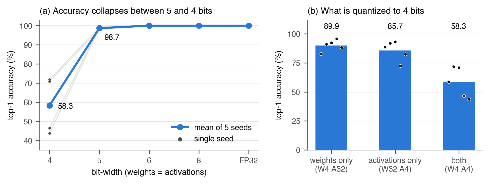
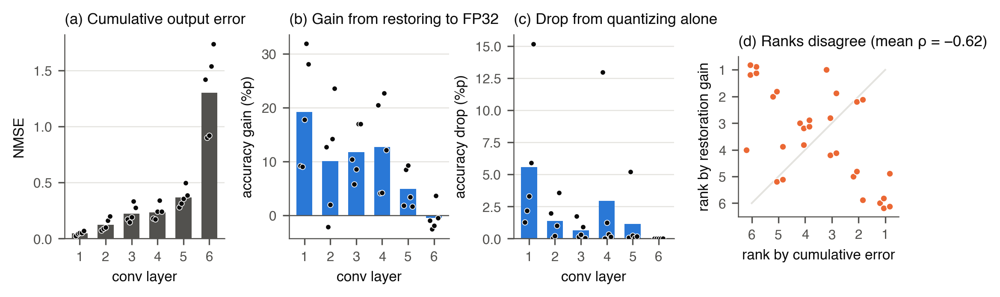
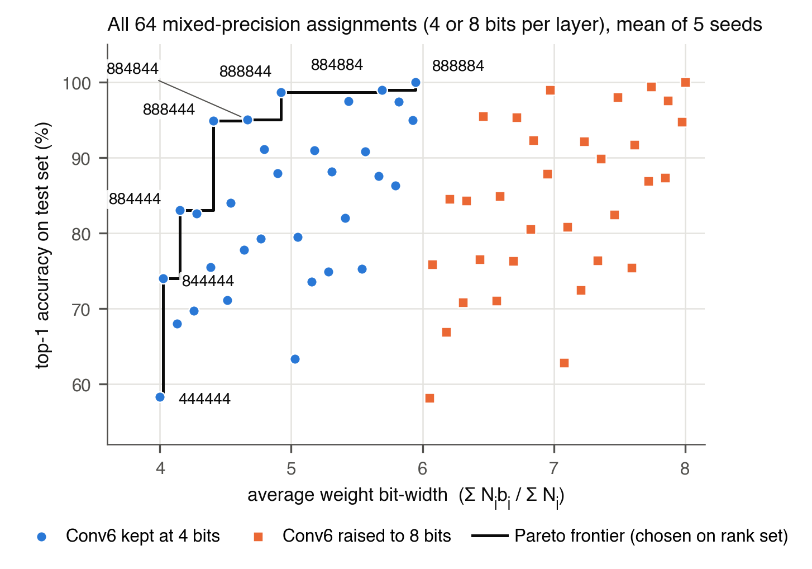
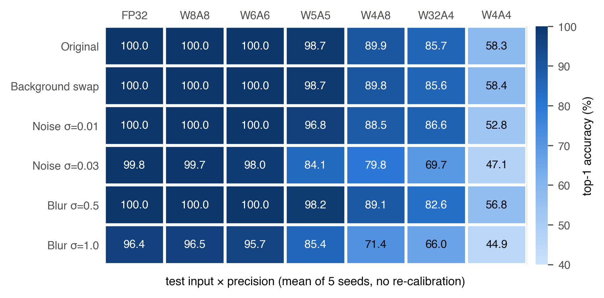

# Layerwise Quantization Error and Accuracy Recovery in Image Classifiers

층별 양자화 오차 vs FP32 복원 효과

팀원: 김진서, 이하형, 정채호준

## 주제

재학습 없이 양자화(PTQ)했을 때, 양자화 오차(NMSE)가 큰 층이랑 FP32로 되돌렸을 때 정확도가 많이 회복되는 층이 같은 층인지 본다.
오차가 큰 층이 꼭 예측을 망치는 층은 아닐 수 있다는 게 가설.

실험은 두 단계로 나눠서 진행한다.

1. 6-Conv CNN + 3D-Shapes : 직접 학습한 작은 모델. Shape / Color / Scale 속성별로 어느 층이 영향을 주는지 확인 (진행 중)
2. ResNet-18, DeiT-Tiny + ImageNet-1K : 사전학습 모델에서도 같은 현상이 나오는지 확인 (아직 구현 안 함)

자세한 설정값은 docs/experiment_spec.md 참고. 아직 확정 안 된 값은 잠정이라고 적어놨음.

## 환경

```bash
pip install -r requirements.txt
```

3D-Shapes 데이터(3dshapes.h5, 약 255MB)는 용량 때문에 레포에 안 올렸다. 아래에서 받아서 `data/3dshapes.h5`로 넣으면 됨.

- https://github.com/deepmind/3dshapes-dataset
- https://storage.googleapis.com/3d-shapes/3dshapes.h5

다른 경로에 두고 싶으면 환경변수 `SHAPES3D_H5`에 경로를 넣으면 된다. 실행할 때 파일 해시(SHA-256)를 확인하니까 다른 파일이면 바로 에러 남.

## 실행 방법

```bash
# 테스트
python -m unittest discover -s tests -t .

# FP32 학습만
python -m src.train --seed 0

# 본 실험 (seed 하나에 M4 맥 기준 13분 정도, 끝난 seed는 건너뜀)
python -m src.exp_6conv --seeds 0 1 2 3 4

# 조건 추가 (학습해둔 모델 그대로 쓰고 조건만 더 돌림, seed 하나에 1분 안쪽)
python -m src.exp_extra --conditions W5A5 --seeds 0 1 2 3 4

# 도메인 실험 1차 (배경 변경, noise, blur. 재학습 없음, 30분 정도)
python -m src.exp_domain --seeds 0 1 2 3 4

# 결과 집계 -> results/6conv_fold/summary/
python -m src.analyze --exp results/6conv_fold

# 그림 -> results/6conv_fold/figures/ (집계 CSV만 읽음)
python -m src.figures --exp results/6conv_fold
```

## 폴더

```
src/
  data.py         데이터 로드, 분할 (모든 seed 동일)
  models.py       6-Conv 모델
  train.py        FP32 학습
  quant/
    fold.py       Conv-BN folding
    quantizer.py  fake quantization
    qmodel.py     folding된 모델 + 층별 on/off, calibration
  exp_6conv.py    본 실험
  exp_extra.py    조건 추가 (W5A5 등)
  exp_domain.py   도메인 실험 1차 (배경, noise, blur)
  analyze.py      집계 (순위 상관, mixed precision, Pareto)
  figures.py      그림
tests/            단위 테스트
docs/             실험 규격
results/          summary랑 그림 PNG만 올림 (모델, 이미지별 예측은 제외)
```

## 실험 설정 (6-Conv)

- 모델: Conv 6개 (16/16/32/32/64/64), MaxPool은 Conv2, 4, 6 뒤에만, GAP + Linear head 3개
- 양자화: W는 symmetric per-channel, A는 asymmetric per-tensor, 둘 다 min-max. calibration 2,048장
- BN은 folding한 다음에 양자화. Head랑 입력 이미지는 양자화 안 함
- 층 하나 = Conv의 W + 그 블록 출력 A
- 조건: FP32, W8A8, W6A6, W5A5, W4A8, W4A4, W32A4, W4A32 (W5A5는 나중에 추가)
- seed 5개 (0~4). 분할은 고정이고 seed는 초기값이랑 학습 순서만 바꿈
- 층 순위는 rank 1만 장으로 정하고, 최종 평가는 test 1만 장으로 따로 함

측정하는 것

| 이름 | 설명 |
|---|---|
| 단독 하락 | FP32 모델에서 한 층만 양자화했을 때 정확도 하락 |
| 복원 이득 | 전부 양자화한 모델에서 한 층만 FP32로 되돌렸을 때 정확도 회복 |
| NMSE | 층 출력 오차. 그 층만 양자화했을 때(단독)랑 전부 양자화했을 때(누적) 둘 다 |
| C→W, W→C | 양자화 전후로 정답/오답이 바뀐 이미지 수 |
| 순위 상관 | NMSE 순위랑 복원 순위의 Spearman ρ, top-k 겹침 |
| Mixed precision | 층마다 4/8비트 고르는 64가지 조합 전부 |

## 6-Conv 결과 (5 seed)

집계 파일은 results/6conv_fold/summary/에 있음. 정확도는 test 1만 장, 세 과제 평균 기준.

| 조건 | 정확도(%) | seed 범위 |
|---|---|---|
| FP32 | 100 | - |
| W8A8 | 100 | 틀리게 바뀐 이미지 0개 |
| W6A6 | 100 | 틀리게 바뀐 이미지 0개 |
| W5A5 | 98.68 ± 0.75 | 97.86 ~ 99.64 |
| W4A32 | 89.94 ± 4.87 | 82.65 ~ 95.65 |
| W4A8 | 89.89 ± 5.00 | 82.36 ~ 95.59 |
| W32A4 | 85.69 ± 8.52 | 72.35 ~ 93.13 |
| W4A4 | 58.31 ± 13.16 | 43.71 ~ 71.76 |



W4A4에서 층별로 본 것 (rank 1만 장, seed 평균)

| 층 | 복원 이득(%p) | 단독 하락(%p) | 누적 NMSE | 단독 NMSE |
|---|---|---|---|---|
| Conv1 | 19.21 | 5.56 | 0.046 | 0.046 |
| Conv2 | 10.08 | 1.36 | 0.123 | 0.044 |
| Conv3 | 11.73 | 0.63 | 0.224 | 0.056 |
| Conv4 | 12.74 | 2.94 | 0.235 | 0.038 |
| Conv5 | 4.91 | 1.15 | 0.365 | 0.038 |
| Conv6 | -0.45 | 0.00 | 1.302 | 0.082 |



검은 점은 seed 하나씩. (d)는 누적 NMSE 순위랑 복원 이득 순위를 seed별로 찍은 것이고, 대각선 위에 있어야 두 순위가 같은 것.

- 8비트, 6비트에서는 정확도가 안 변함. 5비트부터 조금씩 틀리기 시작하고(평균 -1.3%p) 4비트에서 크게 무너짐
  - 5비트에서 제일 많이 떨어지는 과제는 Color (96.95%), Shape은 거의 그대로 (99.91%)
- NMSE 순위랑 복원 이득 순위가 안 맞음. 누적 NMSE 기준 ρ 평균 -0.62, 1등 층은 5개 seed 전부 다름
  - 층이 6개뿐이라 |ρ| 0.886 이상이어야 유의한데, 넘은 건 seed 1개
  - 누적 NMSE는 뒤 층일수록 앞 층 오차가 쌓여서 커지는 것도 감안해야 함
- Conv6은 단독 NMSE가 5개 중 4개 seed에서 제일 큰데, 혼자 양자화했을 때 정확도 하락은 전부 0
- Conv1 ~ 5만 8비트로 두고 Conv6만 4비트로 해도 (평균 5.95비트) 5개 seed 전부 100%
- seed마다 편차가 커서 층 사이의 작은 차이는 해석하기 어려움
- BN folding은 결과에 거의 영향이 없었음. 11/9 예비 실험(folding 없음)이랑 수치가 거의 같음

Mixed precision은 두 가지로 나눠서 봄 (서로 다른 실험)

1. 상위 k개 층만 8비트 (어떤 지표가 중요한 층을 잘 찾는지). test 정확도(%)

| 층 고르는 기준 | k=1 | k=2 | k=3 |
|---|---|---|---|
| 복원 이득 순위 | 76.2 | 90.7 | 95.1 |
| 누적 NMSE 순위 | 58.1 | 62.8 | 77.6 |
| 앞층부터 | 74.0 | 83.0 | 94.9 |
| 무작위 평균 | 67.4 | 75.5 | 84.3 |

2. 같은 저장 비용에서 비교 (B = 층별 가중치 수 x 비트의 합). 64조합의 Pareto frontier, rank로 고르고 test로 평가

| 조합 (Conv1~6 비트) | 평균 비트 | test 정확도(%) |
|---|---|---|
| 444444 | 4.00 | 58.31 ± 13.16 |
| 844444 | 4.02 | 73.98 ± 11.06 |
| 884444 | 4.15 | 82.99 ± 8.30 |
| 888444 | 4.41 | 94.89 ± 3.30 |
| 884844 | 4.67 | 95.03 ± 3.60 |
| 888844 | 4.92 | 98.67 ± 2.70 |
| 884884 | 5.69 | 98.94 ± 1.27 |
| 888884 | 5.95 | 100.00 |



- frontier가 거의 "앞 층부터 8비트"임. 앞 층은 가중치 수가 적어서 싸고, 복원 이득도 커서 그런 것
- 그래서 비트 예산을 평균 5, 6으로 맞추면 어떤 순위를 쓰든 같은 조합(888844, 888884)이 나옴. 점수를 비용으로 나눠서 골라도 마찬가지
- 예산 7에서는 NMSE 순위만 Conv6을 먼저 골라서 100%가 안 됨 (98.9%)

## 도메인 실험 1차 (5 seed)

학습해둔 모델은 그대로 두고 평가 이미지만 바꿈. calibration도 원본 이미지로 한 것 그대로. test 1만 장, 세 과제 평균(%).

| 입력 | FP32 | W8A8 | W6A6 | W5A5 | W4A8 | W32A4 | W4A4 |
|---|---|---|---|---|---|---|---|
| 원본 | 100 | 100 | 100 | 98.68 | 89.89 | 85.69 | 58.31 |
| 배경(벽, 바닥 색) 변경 | 100 | 100 | 100 | 98.71 | 89.81 | 85.59 | 58.35 |
| Noise σ=0.01 | 100 | 100 | 100 | 96.77 | 88.55 | 86.62 | 52.76 |
| Noise σ=0.03 | 99.78 | 99.69 | 98.01 | 84.11 | 79.80 | 69.69 | 47.06 |
| Blur σ=0.5 | 100 | 100 | 100 | 98.18 | 89.14 | 82.61 | 56.76 |
| Blur σ=1.0 | 96.43 | 96.47 | 95.72 | 85.42 | 71.43 | 65.99 | 44.93 |



- 배경만 바꾼 건 차이 없음. 근데 지금 모델은 벽, 바닥 색을 학습 때 전부 봤기 때문에 이건 분포 변화 실험은 아님 (그건 색 조합을 빼고 다시 학습해야 해서 2차로 미룸)
- Noise σ=0.03은 FP32에서는 거의 안 떨어지는데(99.78) 비트가 낮을수록 많이 떨어짐. W6A6 98.01, W5A5 84.11
  - seed 편차도 커짐. W5A5 표준편차가 원본 0.75에서 15.52로
  - Conv1만 W4A4로 했을 때 하락이 원본 5.6%p에서 26.9%p로 커짐
- Blur σ=1.0은 FP32부터 떨어지고(96.43, 주로 Scale) 양자화하면 더 떨어짐
- 누적 NMSE 순위와 복원 이득 순위가 안 맞는 건 모든 입력에서 똑같이 나옴 (ρ 평균 -0.52 ~ -0.62, 1등 층 겹침 0)
- 복원 이득 순위 자체는 입력이 바뀌어도 대체로 유지됨 (원본 순위와의 ρ 평균 0.77 ~ 0.99). Conv1이 계속 1등인 경우가 많음
